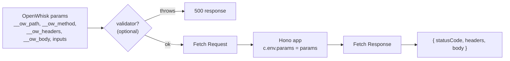

<div align="center">

# hono-openwhisk-adapter

**Run [Hono](https://hono.dev/) apps as [Apache OpenWhisk](https://openwhisk.apache.org/) and [Adobe App Builder](https://developer.adobe.com/app-builder/) web actions.**

[](https://www.npmjs.com/package/hono-openwhisk-adapter)
[](https://www.npmjs.com/package/hono-openwhisk-adapter)
[](https://github.com/ahmed-musallam/hono-openwhisk-adapter/actions/workflows/ci.yml)
[](LICENSE)

[Quick start](#-quick-start) · [Action params](#-action-params) · [Validation](#-validating-action-params) · [Routing](#-routing) · [API](#-api-reference) · [FAQ](#-faq)

</div>

---

## ✨ Why?

OpenWhisk web actions receive `__ow_*` params and return `{ statusCode, body }`.
This adapter maps them to a standard `Request`/`Response`, so you write plain Hono.

<table>
<tr><th>Without the adapter</th><th>With the adapter</th></tr>
<tr>
<td>

```js
export async function main(params) {
  // the HTTP request arrives as __ow_* params
  const path = params.__ow_path;
  const method = params.__ow_method;
  // JSON bodies arrive base64-encoded
  const raw = atob(params.__ow_body);
  const pet = JSON.parse(raw);
  // ...hand-rolled routing
  if (method === "post" && path === "/pets") {
    const body = JSON.stringify(pet);
    return { statusCode: 201, body };
  }
  return { statusCode: 404 };
}
```

</td>
<td>

```ts
const app = new Hono();

app.post("/pets", async (c) => {
  const pet = await c.req.json();
  return c.json(pet, 201);
});

export const main = ToOpenWhiskAction(app);
```

</td>
</tr>
</table>

- 🧭 **Full Hono routing and middleware.** Path params, `app.onError`, CORS, and more.
- 🔒 **Typed action params.** Access `inputs` and `__ow_*` params with types through `c.env.params`.
- ✅ **Optional param validation** with any library (Zod helper included).
- 📦 **Correct body handling.** Decodes base64 bodies for JSON and binary types, and keeps text bodies as plain strings.
- 🪶 **Small.** The only required peer dependency is `hono`.

### Why Hono?

- 🌐 **Web standards.** Hono uses the standard `Request`/`Response` APIs that [WinterTC](https://wintertc.org/) defines across server-side JavaScript runtimes.
- ⚡ **Made for serverless.** Hono is small and fast, and it runs on runtimes with strict CPU and memory limits, such as Cloudflare Workers. That also suits short-lived actions with cold starts.
- 🔁 **Portable.** The same app runs on [Cloudflare Workers, Deno, Bun, Node.js, and more](https://hono.dev/docs/getting-started/basic). Moving off OpenWhisk only means changing the entry point.

## 🚀 Quick start

**1. Install**

```bash
npm install hono-openwhisk-adapter hono
```

**2. Write your action**

```ts
// actions/my-action.ts
import { Hono } from "hono/quick";
import { ToOpenWhiskAction } from "hono-openwhisk-adapter";

const app = new Hono();

app.get("/hello", (c) => c.text("Hello!"));
app.get("/*", (c) => c.text("Fallback"));

export const main = ToOpenWhiskAction(app);
```

> [!TIP]
> `hono/quick` is a good fit for serverless actions, which start cold often. See [Hono presets](https://hono.dev/docs/api/presets).

**3. Make it a raw web action**

> [!IMPORTANT]
> The action **must** use `web: raw` (the same as the `raw-http: true` [annotation](https://github.com/apache/openwhisk/blob/master/docs/annotations.md)). Without it, the adapter cannot rebuild the HTTP request.

On Adobe App Builder, set it in your `*.config.yaml`:

```yaml
application:
  runtimeManifest:
    packages:
      my-package:
        actions:
          my-action:
            function: actions/my-action.ts
            web: "raw"
            runtime: nodejs:22
            inputs:
              MY_VAR_ONE: $ENV_VAR_ONE
              MY_VAR_TWO: $ENV_VAR_TWO
```

On plain OpenWhisk:

```bash
wsk action create my-action dist/my-action.js --web raw
```

That's it. `GET <action-url>/hello` now returns `Hello!`.

## 🔑 Action params

`c.env.params` contains all action params: your `inputs` and the raw HTTP params (`__ow_path`, `__ow_method`, `__ow_headers`, and others). To type them, pass your params to `OwEnv<TParams>`:

```ts
import { Hono } from "hono/quick";
import { ToOpenWhiskAction, type OwEnv } from "hono-openwhisk-adapter";

// Match the `inputs` in your *.config.yaml
type MyParams = {
  MY_VAR_ONE: string;
  MY_VAR_TWO: string;
};

const app = new Hono<OwEnv<MyParams>>();

app.get("/config", (c) =>
  c.json({
    // raw HTTP params are always included
    path: c.env.params.__ow_path,
    myVarOne: c.env.params.MY_VAR_ONE,
    myVarTwo: c.env.params.MY_VAR_TWO,
  }),
);

export const main = ToOpenWhiskAction(app);
```

`OwEnv<TParams>` types `c.env.params` as `TParams & OwRawHttpParams`. Without the generic, it is `OwRawHttpParams`.

## ✅ Validating action params

Pass a **validator function** as the second argument to `ToOpenWhiskAction`. It receives the raw action params and should **throw** when they are invalid. It can be async.

> [!NOTE]
> If validation fails, the adapter logs the error and returns a generic `500 Internal Server Error: action params validation failed`. The response does not include the error details, so private inputs are not exposed.

<details open>
<summary><b>With Zod (built-in helper)</b></summary>

```bash
npm install zod
```

```ts
import { Hono } from "hono/quick";
import { z } from "zod";
import { ToOpenWhiskAction, zodOwParamsValidator } from "hono-openwhisk-adapter";
import type { OwEnv } from "hono-openwhisk-adapter";

const ParamsSchema = z.object({
  MY_VAR_ONE: z.string().nonempty(),
  MY_VAR_TWO: z.string().nonempty(),
});

type Params = z.infer<typeof ParamsSchema>;

const app = new Hono<OwEnv<Params>>();

app.get("/config", (c) => {
  return c.json({ myVarOne: c.env.params.MY_VAR_ONE });
});

const validator = zodOwParamsValidator(ParamsSchema);
export const main = ToOpenWhiskAction(app, validator);
```

</details>

<details>
<summary><b>With ArkType or any other library</b></summary>

```ts
import { type } from "arktype";

const Params = type({
  MY_VAR_ONE: "string",
  MY_VAR_TWO: "string",
});

export const main = ToOpenWhiskAction(app, (params) => {
  Params.assert(params); // throws if invalid
});
```

</details>

## 🧭 Routing

Hono routes match the part of the URL **after the action name**:

```
https://<host>/api/v1/web/my-package/my-action/pets/dragon/abilities
                                             └──── Hono path ────┘
                                              /pets/dragon/abilities
```

```ts
app.get("/pets", (c) => c.json({ count: pets.length, pets }));

app.get("/pets/:type", (c) => {
  const pet = petStore[c.req.param("type").toLowerCase()];
  return pet ? c.json(pet) : c.json({ error: "Not found" }, 404);
});

app.get("/pets/:type/abilities", (c) => {
  return c.json(getAbilities(c.req.param("type")));
});
```

For more, see [Hono routing](https://hono.dev/docs/api/routing).

## 🔄 How it works



- **Request body:** OpenWhisk sends `__ow_body` as **base64** for `application/json` and binary types (images, PDFs, archives, and others), and as **plain UTF-8** for text types. The adapter decodes it based on the `Content-Type`.
- **Malformed params:** If the request can't be built from the params, the adapter returns `400 Bad Request` before Hono runs.

## 📚 API reference

| Export                                      | Description                                                                                            |
| ------------------------------------------- | ------------------------------------------------------------------------------------------------------ |
| `ToOpenWhiskAction(app, validator?)`        | Wraps a Hono app and returns an OpenWhisk `main` function.                                             |
| `zodOwParamsValidator(schema)`              | Creates a validator from a Zod schema. Requires the optional `zod` peer dependency.                    |
| `OwEnv<TParams>`                            | Hono env type that makes `c.env.params` typed.                                                         |
| `OwRawHttpParams`                           | Type for the raw HTTP params (`__ow_path`, `__ow_method`, `__ow_query`, `__ow_headers`, `__ow_body`).  |
| `OwParamsValidator<TParams>`                | Type for validator functions: `(params) => void \| Promise<void>`.                                     |
| `OwActionResponse`, `OwResponseHeaders`     | Types for the action response. Header values can be arrays, for example multiple `Set-Cookie` headers. |
| `encodeOwRawHttpBody(body, contentType)`    | Encodes a body the way OpenWhisk does in `__ow_body`. Useful for local tests.                          |
| `isOwRawHttpBodyBase64Encoded(contentType)` | Returns `true` if OpenWhisk base64-encodes bodies with this `Content-Type`.                            |

## ❓ FAQ

<details>
<summary><b>My routes always 404 or the request looks empty</b></summary>

Make sure the action is deployed with `web: raw` (see [Quick start](#-quick-start)). Without it, OpenWhisk does not send the `__ow_*` params that the adapter needs.

</details>

<details>
<summary><b>How do I unit test my action locally?</b></summary>

Call `main` directly with fake params. Use `encodeOwRawHttpBody` to encode the body the same way OpenWhisk does:

```ts
import { encodeOwRawHttpBody } from "hono-openwhisk-adapter";
import { main } from "./actions/my-action";

const type = "application/json";
const body = JSON.stringify({ name: "Rex" });

const res = await main({
  __ow_method: "post",
  __ow_path: "/pets",
  __ow_headers: { "content-type": type },
  __ow_body: encodeOwRawHttpBody(body, type),
});
```

</details>

<details>
<summary><b>Does it work with Hono middleware?</b></summary>

Yes. The adapter calls `app.fetch` with a standard `Request`, so any Hono middleware works (`cors`, `logger`, `app.onError`, and others).

</details>

## 🤝 Contributing

```bash
npm install
npm run test:run     # unit tests
npm run lint         # oxlint
npm run fmt:check    # oxfmt
npm run build        # build to dist/
```

To try your changes in another project, run `npm run build && npm link` here, then run `npm link hono-openwhisk-adapter` in that project. Run `npm run build` again after each change.

Releases are published automatically by [semantic-release](https://github.com/semantic-release/semantic-release). Use [Conventional Commits](https://www.conventionalcommits.org/) for commit messages: `fix:` creates a patch release, `feat:` a minor release, and `feat!:` or `BREAKING CHANGE:` a major release.

## 📄 License

[Apache-2.0](LICENSE)
